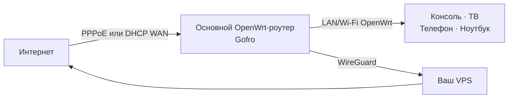

<p align="center">
  
</p>

<p align="center">
  <strong>Превратите роутер с OpenWrt в сеть с VPN.</strong><br>
  Подключайте телевизор, консоль, телефон или ноутбук без VPN-приложений на каждом устройстве.
</p>

<p align="center">
  
  
  
  
</p>

## VPN на OpenWrt

**Gofro Router** добавляет VPN на основной роутер с OpenWrt 25.12;
отдельный роутер за домашним DHCP-uplink тоже подходит. OpenWrt продолжает
управлять PPPoE/DHCP, учётными данными, MTU, LAN, DHCP, Wi-Fi и LuCI.
Gofro не создаёт отдельную Wi-Fi-сеть и не меняет эти настройки.

Здесь описана подготовка следующего подписанного кандидата `0.5.25`.
Опубликованный v0.5.23 остаётся неизменяемой закреплённой базой; новые изменения
требуют нового кандидата. Ссылки установки ведут на опубликованный Latest,
а не на текущие изменения исходников.

## Платформа

Gofro не привязан к производителю или модели: установщик выбирает
статический бинарник по ABI устройства. Поддерживаемые ABI и требования
перечислены в [инструкции OpenWrt](deploy/openwrt/README.md). Собственных образов
прошивки здесь нет.

Минимум для compact-профиля — **64 МиБ RAM** (OpenWrt должен видеть не менее 48 МиБ).
На устройствах с менее чем 96 МиБ видимой памяти этот профиль выбирается автоматически;
на более ёмких устройствах используется standard-профиль.
Агент загружает только используемые GeoSite/GeoIP-теги; релиз содержит компактную
IPv4-базу, а установщик распаковывает его на постоянном хранилище. Для установки
или обновления требуется примерно **32 МиБ свободного места** в разделе `/usr/lib`.

Установщик добавляет:

- `gofro-agent` - локальный контроллер и web-панель;
- `gofro-relay` - обфусцированный UDP-транспорт для WireGuard;
- сервисы `procd`;
- GeoSite/GeoIP данные для раздельной маршрутизации.

Rust workspace разделён по runtime-ролям:

- `gofro-agent` управляет API, FakeDNS и маршрутизацией;
- `gofro-kdf` вычисляет совместимый scrypt-хеш с 2 МиБ рабочей памяти;
- `gofro-server` добавляет и удаляет WireGuard peers на VPS;
- `wireguard-status` читает и разбирает `wg show ... dump`;
- `gofro-relay` передаёт WireGuard-пакеты между роутером и VPS.

## Установка

Настройте LAN, WAN, DHCP, Wi-Fi, регион и LuCI в OpenWrt до установки.
Отключите software и hardware flow offloading сами: helper откажет при
включённом offloading, но не изменит его. Требуется проверенный логический
`lan` в собственной эксклюзивной firewall-зоне; имя зоны может быть не `lan`.
Затем на свежем
совместимом роутере с OpenWrt 25.12 выполните:

```sh
tmp="$(mktemp)" && trap 'rm -f "$tmp"' EXIT && uclient-fetch -q -O "$tmp" https://github.com/gofronet/gofro-router/releases/latest/download/gofro-install && sh "$tmp" --install
```

После установки консоль выводит одноразовый код и 15-минутное окно настройки.
Первый пользователь с кодом создаёт администратора и настраивает только VPN через
импорт профиля или VPS. Сеть не меняется. Подробности: [OpenWrt](deploy/openwrt/README.md).

## Схема сети



1. OpenWrt получает uplink по DHCP или PPPoE.
2. OpenWrt управляет LAN, DHCP, Wi-Fi и LuCI; Gofro не меняет подсеть LAN.
3. FakeDNS и nftables выбирают прямой маршрут, VPN или блокировку.
4. WireGuard передаёт VPN-трафик через ваш VPS.

DNS TCP/UDP обеих IP-семей перенаправляется с LAN:53 на 5353; сокеты
ограничены LAN-устройством через `SO_BINDTODEVICE`.

### DNS следует защищённому маршруту

- **Direct** использует нативный dnsmasq на LAN IPv4:53, как и раньше.
- **VPN** запрашивает `1.1.1.1:53` через VPN, не через dnsmasq или его общий кэш.
- **VPN → WARP** запрашивает `1.0.0.1:53` через VPN и native WARP на VPS.
  DNS получает отдельную WARP source alias, как выбранный трафик сайта.
  Разные адреса Cloudflare для VPN/WARP исключают смешивание их conntrack
  при повторном использовании короткоживущими UDP-сокетами исходного порта.
- **Блокировка** не обращается к upstream, если правило уже определяет запрет.
  При недоступном VPN/WARP запрос завершается ошибкой, без повторной попытки
  через Direct/провайдерский DNS. UDP → TCP сохраняет тот же маршрут.

Исходная подсеть клиента из EDNS Client Subnet удаляется у защищённых запросов;
другие EDNS-параметры и DNSSEC DO сохраняются. `wifi.gofro.net`, локальные
одноуровневые имена, зоны `.lan`, `.local`, `.home`, `.home.arpa`, `.internal`,
`localhost` и private reverse DNS остаются локальными. Исключённые устройства
**Direct** сохраняют обычные DNS и IPv6 OpenWrt.

Адрес ответа ещё неизвестен до DNS. Поэтому агент использует порядок доменных
правил и наиболее защищённый из возможных предшествующих IP-маршрутов
(WARP, затем VPN, затем Direct), а не предварительный запрос к провайдеру.
IP-only правило может сделать DNS более защищённым, чем последующий трафик;
это не меняет сам порядок IP/доменных правил для соединений. Режим
**Весь интернет** использует VPN DNS; при намеренном выключении VPN обычный
VPN DNS возвращается в Direct, а WARP остаётся заблокированным.

Это относится к DNS, проходящему через DNS роутера. Внешний DoH клиента
не раскрывает агенту имя внутри HTTPS и не позволяет выбирать отдельный
DNS-маршрут для каждого такого запроса; перехват TLS не выполняется.

## Управление

Откройте `wifi.gofro.net` без порта из LAN — это панель
Gofro. Нужен локальный LAN-резолвер роутера: внешний DNS/DoH не обеспечивает
этот доступ. Локальный DNS возвращает зарезервированный VIP `198.18.0.0`
с TTL 30 секунд; адрес исключён из выдачи FakeDNS leases. Если клиент сохранил
старый DNS-ответ, дождитесь истечения его прежнего TTL или очистите DNS-кэш
и обновите разрешение имени.

Только для TCP из LAN к VIP порты `80`/`8081` перенаправляются на существующий
LAN listener `8081`, а `443`/`8443` — на существующий `8443`. Проверки Host/Origin
строго допускают канонический alias `wifi.gofro.net`; проверки LAN-адреса
сохранены. Дополнительный LAN IP, proxy или listener не нужны.
Все существующие порты панели и LuCI сохраняются, включая LuCI `80`/`443`.

Прямой доступ остаётся прежним: `https://<LAN-адрес>:8443`, а
`http://<LAN-адрес>:8081` перенаправляет на него. Используйте прямой HTTPS-адрес,
если домен недоступен, особенно при неудаче первого reconcile: VIP требует
успешного применения правил. Например, `192.168.0.1` задаётся в OpenWrt
до установки, а не установщиком Gofro.

В панели можно:

- включать и отключать VPN, выбирать режим **По правилам** или **Весь интернет**;
- добавлять и выбирать VPN-серверы;
- управлять своим VPS и именными доступами друзей: создавать, переименовывать,
  скачивать `wg.conf` повторно и отзывать доступ;
- задавать правила GeoSite, GeoIP, доменов и подсетей в общем списке: первое
  подходящее правило выбирает VPN, **VPN → WARP**, прямой маршрут или блокировку;
- видеть состояние туннеля;
- выбирать светлую, тёмную или системную тему, обновлять и перезагружать роутер.

Режим **Весь интернет** отправляет публичный трафик через VPN, сохраняя правила
для возврата в режим **По правилам**. Локальные адреса доступны напрямую.
В разделе **Остальные сайты** задаётся маршрут для трафика без совпадения.
Проверка домена предварительная: IP-зависимые правила учитываются после DNS.
Перезагрузка недоступна во время обновления и не удаляет настройки.

Если VPN пропадает, таблица маршрутизации остаётся fail-closed и не отправляет
помеченный VPN-трафик через обычный WAN.

Boot guard (`START=18`) использует сохранённый root-owned
`/etc/gofro/guard-device` и блокирует forwarding до запуска WAN и полного
reconcile совместимым агентом. Остановка агента сохраняет блокировку и
возвращает нативный DNS с очисткой принадлежащих Gofro DNS-потоков через
нативный `conntrack`. Перенумерация адреса на том же LAN-устройстве
поддерживается. Смена LAN-устройства/зоны, `fw4 stop` и flush всего ruleset
требуют согласованного обслуживания; обычный fw4 reload сохраняет таблицы Gofro.
Подробные ограничения и миграция только подтверждённого состояния v0.5.15:
[OpenWrt](deploy/openwrt/README.md#guard-and-maintenance).

Нажмите название сервера в разделе **VPN → Серверы**, чтобы открыть управление.
Проверка доступности, обновление и перезапуск VPN доступны только для своего
VPS, добавленного через SSH. Перезапуск VPN временно прерывает подключения
владельца и друзей; отзыв одного друга не затрагивает пир роутера и других друзей.

Имена и ключи новых доступов хранятся на VPS в
`/etc/gofro/friends/<interface>.json` с правами `0600` в каталоге `0700`.
Списки доступа не содержат приватных ключей; конфигурация запрашивается отдельно
при нажатии **Поделиться**. Старые пиры можно переименовать и отозвать, но повторно
скачать их конфигурацию нельзя, если приватный ключ не был сохранён при создании.
Для новых команд управления нужно обновить серверный пакет Gofro на VPS;
старая версия покажет сообщение о необходимости обновления.

### Выборочный выход через Cloudflare WARP

В управлении своим VPS откройте **Cloudflare WARP → Включить**, прочитайте
и подтвердите условия Cloudflare. Gofro получает WARP-профиль через закреплённый
`wgcf` (неофициальная утилита регистрации), а трафик передаёт **WireGuard в ядре Linux**
в отдельном сетевом пространстве VPS, без `warp-svc`, MASQUE и userspace-прокси.
SSH, DNS самого VPS и обычный VPN-трафик
сохраняют прежний выход. Уже установленный сторонний WARP автоматически не заменяется.
Автоустановка поддерживает Debian 12/13 и Ubuntu 22.04/24.04/26.04.
Доступность API регистрации и WireGuard-выхода проверяется на самом VPS;
при ошибке Gofro не переключает WARP-правила на другой транспорт или обычный IP.
Скорость зависит от маршрута и узла Cloudflare, поэтому её нужно измерять, а не
считать любой транспорт безусловно самым быстрым.

В режиме **По правилам** задайте сайту цель **VPN → WARP**. Например, правило
«Сайт целиком», значение `elevenlabs.io`, включает сам домен и его поддомены:

```text
выбранный сайт: устройство → роутер → VPS → WARP → сайт
обычный VPN:    устройство → роутер → VPS → сайт
Direct:        устройство → роутер → сайт
```

Обновить нужно обе стороны. WARP требует управляемого VPS с импортированным
адресом туннеля. Без подходящего профиля, при выключенном VPN или отключённом
WARP эти правила блокируют трафик, а не переключаются напрямую. Отключение WARP
на VPS затрагивает все использующие его роутеры, но не обычный VPN и доступы друзей.
Режим **Весь интернет** по-прежнему временно игнорирует все правила, включая WARP.
Исключение устройства **Direct** по-прежнему обходит все правила Gofro.

WARP не гарантирует доступ к ElevenLabs или другим сайтам и не предоставляет
выбор страны выхода. Доменные правила требуют DNS роутера; внешний DoH и
подключения к заранее известному IP не позволяют Gofro определить домен.
IPv6 для управляемых устройств блокируется также при активных WARP-правилах
с выключенным VPN; это предотвращает обход IPv4-политики. После смены маршрута
существующее соединение может потребовать переподключения.

Протокол, диагностика, ограничения и тесты: [WARP на VPS](deploy/server/README.md).

### Устройство напрямую (кандидат v0.5.18)

Откройте **Правила → Устройства** и включите **Direct** для нужного устройства.
Если его нет в списке, добавьте MAC вручную. Выключение Direct возвращает
устройство под общие правила Gofro. Исключение действует по исходному MAC
на LAN: обходит VPN, правила блокировки, FakeDNS, IPv6-блокировку Gofro и
fail-closed guard, в том числе при недоступном VPN. Обычные DNS, IPv6,
маршрутизация и firewall OpenWrt продолжают действовать.

Список устройств — только подсказка из доступного LAN/DHCP-инвентаря;
DHCP читается без изменений и не участвует в enforcement. При ротации
приватного MAC добавьте новый адрес или закрепите MAC для этой Wi-Fi-сети.
За downstream-роутером с NAT виден MAC этого роутера, а не отдельных клиентов:
исключение распространяется на весь приходящий с него трафик.

В `/etc/gofro/controller.json` список `device_exclusions` находится на верхнем
уровне, не внутри `routing`. API: `POST /api/device-exclusions` меняет одно
исключение (`{"mac":"02:00:00:00:00:01","excluded":true}`),
`GET /api/lan-devices` возвращает инвентарь для панели.

На роутере требуется нативный пакет `conntrack` для helper `dns-flows`.
Gofro добавляет собственную запись dnsmasq `hostrecord` для `wifi.gofro.net`,
чтобы панель разрешалась и через нативный DNS исключённого устройства.
Conntrack-бит `0x40000000` зарезервирован за Gofro для владения LAN DNS-потоками;
совместное использование этого бита другими пакетами не поддерживается.
Очистка ограничена этим DNS-владением и распознанными старыми Gofro DNS DNAT,
а не всей таблицей соединений. После переключения существующим NAT-соединениям
и DNS-кэшу клиента может потребоваться переподключение или очистка кэша.
Direct не обещает нулевых накладных расходов и не разрешает flow offloading:
общий отказ при включённом software/hardware offloading сохраняется.

## `gofro-relay`

### MTU и QUIC (v0.5.22)

Обновите роутер и VPS вместе: обе стороны туннеля используют MTU **1379**.
Это оставляет место для WireGuard, relay и IPv4/UDP в uplink с MTU 1480 и
пропускает обычные QUIC-датаграммы 1350 байт без фрагментации. QUIC не блокируется.
Агент сохраняет MTU из OpenWrt UCI при старте и переключении сервера; TCP MSS
ограничивается в обоих направлениях VPN. Установщик VPS также исправляет старый
MTU 1280 при обновлении, сохраняя явно заданные нестандартные значения.

Для uplink меньше 1480 настройте меньший MTU согласованно на обоих концах.
На клиенте старый PMTU может оставаться в кэше до истечения срока или
переподключения сети. IPv6, который не поддерживается VPN, получает явный отказ
для быстрого возврата к IPv4; исключённые устройства используют обычный OpenWrt.

WireGuard шифрует трафик, но его UDP-пакеты имеют узнаваемую структуру.
`gofro-relay` меняет внешнюю форму уже зашифрованных пакетов:

```text
WireGuard на Gofro Router
    -> локальный gofro-relay
    -> UDP-порт 8443 на VPS
    -> серверный gofro-relay
    -> WireGuard на VPS
```

Relay не расшифровывает пользовательский трафик и не заменяет безопасность
WireGuard. Это транспортная обфускация против базового распознавания протокола,
а не дополнительное шифрование или имитация HTTPS.

## Что понадобится

- совместимый роутер с официальным OpenWrt 25.12;
- заранее настроенное подключение WAN: DHCP или PPPoE;
- VPS с публичным IPv4;

## Обновления

Gofro автоматически проверяет GitHub каждые шесть часов. Для немедленной
проверки откройте раздел **Панель** и нажмите **Проверить
обновления**. Updater проверяет подписанный release-архив, атомарно переключает
версию и возвращает предыдущую при неудачном health check или прерванном
обновлении. Конфигурация в `/etc/gofro` и OpenWrt UCI не перезаписывается.

После неудачного guarded rollback на v0.5.15 управление может восстановиться,
но forwarding остаётся заблокированным до полного reconcile совместимым
агентом. Новый агент возвращает HTTP `503` при degraded health; доступная
панель не означает здоровый dataplane. Финализация не снимает guard ради успеха.

Процедура выпуска описана в [RELEASING.md](RELEASING.md).
